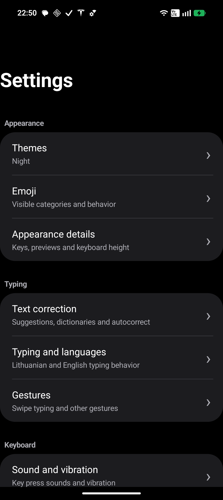

<p align="center">
  
</p>

<h1 align="center">Baltboard</h1>
<p align="center">A modern Lithuanian &amp; English keyboard for Android.<br>Comfortable typing. Your words. Optional AI assistance.</p>
<p align="center">
  <a href="https://github.com/Karolynaz/Baltboard/releases/download/v2.0.35/Baltboard-v2.0.35.apk"><strong>Download APK</strong></a>
  &nbsp;·&nbsp;
  <a href="https://github.com/Karolynaz/Baltboard/releases">Release notes</a>
  &nbsp;·&nbsp;
  <a href="docs/README.lt.md">Lietuviškai</a>
</p>

Baltboard brings Lithuanian characters, English QWERTY, clean Day/Night themes, clipboard history and emoji into one keyboard. It is a customized version of [AnySoftKeyboard](https://github.com/AnySoftKeyboard/AnySoftKeyboard), with optional AI rewriting and natural translation into English.

> **Testing release:** Android 6.0+ · Package: `lt.klaviatura.advanced` · Current APK: **2.0.35**. This is a sideloaded test build, not a Google Play production release.

## See it in action

<p align="center">
  
</p>

Real settings screenshot from the installed **2.0.34** version. The 2.0.35 release adds reviewed reliability fixes.

## What makes it useful

- **Lithuanian + English:** included QWERTY layouts and dictionaries; a dedicated `ą č ę ė į š ų ū ž` row for Lithuanian and a number row for English.
- **Quick language switching:** swipe across the spacebar; the keyboard remembers your last language.
- **Day, Night or Auto:** a light or dark keyboard, with Auto following Android's dark-mode setting.
- **Suggestions and correction:** configurable word suggestions, dictionaries, autocorrect and swipe typing.
- **Clipboard history:** up to 20 text entries in a two-column grid. Copying the same text moves it to the top rather than keeping duplicates. Select entries to delete them.
- **Recent-copy shortcut:** a temporary paste preview in the toolbar, with an X to dismiss it.
- **Emoji without interruption:** categories and recents; choosing an emoji keeps the picker open by default. Returning to the keyboard after selection is optional.
- **Optional AI rewrite:** spelling, grammar and more natural wording, with editable instructions.
- **Optional AI translate:** translate your intended meaning into natural English, rather than word-for-word phrasing.
- **Preview before applying:** copy the AI result, replace the captured text, cancel, or retry after an error. Text is not automatically replaced when the result arrives.
- **English / Lithuanian settings:** the interface follows the Android system language, independently of the active typing layout.

## Install on your phone

1. Download [**Baltboard-v2.0.35.apk**](https://github.com/Karolynaz/Baltboard/releases/download/v2.0.35/Baltboard-v2.0.35.apk) on your Android phone.
2. Open it. If Android asks, allow installation from the browser or file manager you used. You can turn that permission off again afterward.
3. Install and open **Baltboard**.
4. Follow **Information → Enable keyboard** to enable it and select it as your current keyboard.
5. Type normally. Swipe the spacebar to switch between **LT** and **EN**.

Lithuanian and English dictionaries are bundled; you do **not** need the separate “Lithuanian for AnySoftKeyboard” app.

For updates, install the new APK over the existing app. The signing certificate must match. This personal test build is non-debuggable but signed with the local Android debug certificate; it is not signed for Play Store distribution.

## AI rewrite & translate

AI is optional: normal typing does not require an API key.

1. Open **Settings → AI rewrite & translate**.
2. Choose the provider, enter your own API key and check the model ID. **Gemini is the default provider.** The app also has adapters for OpenAI, Claude and Grok; access depends on your provider account and model.
3. Save, then use the **⋯** menu in the API-key field to test the connection.
4. Enable rewriting, translation, or both. Each adds its own toolbar button.
5. Write your text, tap the desired action, then review the result before copying or replacing it.

Correction and translation instructions can be edited separately. Translation currently targets **English**. AI model access, charges and limits are controlled by the provider; a chat-app subscription is not an API key.

Read [Privacy & troubleshooting](docs/PRIVACY-AND-HELP.md) before enabling network-based AI features.

## Source code and development

The complete source for this build is [**Baltboard-v2.0.35-source.zip**](https://github.com/Karolynaz/Baltboard/releases/download/v2.0.35/Baltboard-v2.0.35-source.zip).

**For now, `main` contains the project presentation, not the full application source.** The original Git upload was rejected by the local GitHub credential. Download the specifically named source asset above—not GitHub's automatically generated “Source code” archives.

Extract the snapshot and follow its build instructions. Android code uses Gradle; some upstream tooling uses Bazel. No API key or signing key is included in the snapshot.

```sh
# With JDK 21 and the required Android SDK installed:
./gradlew :ime:app:assemblePersonal
./gradlew :ime:app:testDebugUnitTest --tests 'lt.klaviatura.advanced.*'
```

The APK is generated at `ime/app/build/outputs/apk/personal/app-personal.apk`.

For **2.0.35**, 125 selected Android unit tests passed and one was skipped. The APK was assembled and its signature verified. This is targeted regression coverage, not a guarantee of compatibility with every phone or editor.

## Report a problem

Open a [GitHub issue](https://github.com/Karolynaz/Baltboard/issues). Include your phone model, Android version, Baltboard version, the affected app, and steps to reproduce. A short screen recording or redacted screenshot helps. **Never post API keys, passwords or private clipboard contents.**

## Open source & credits

Baltboard is based on and includes code from **[AnySoftKeyboard](https://github.com/AnySoftKeyboard/AnySoftKeyboard)**. Thanks to its original contributors and language-pack authors. The source snapshot preserves upstream notices and credits.

Licensed under the **[Apache License, Version 2.0](LICENSE)**. Baltboard is a customized project, not an official AnySoftKeyboard release. The visual design of the Day/Night keyboard themes builds on Yochees themes by Algimantas.
